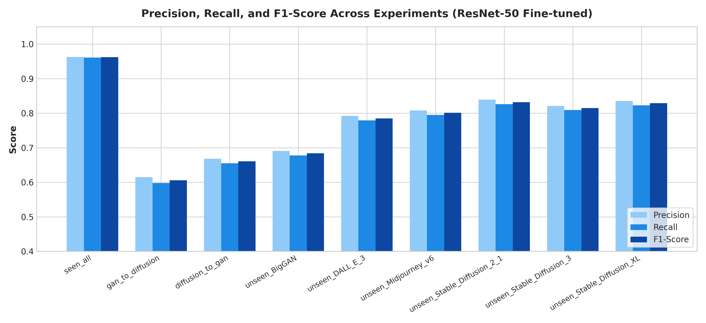
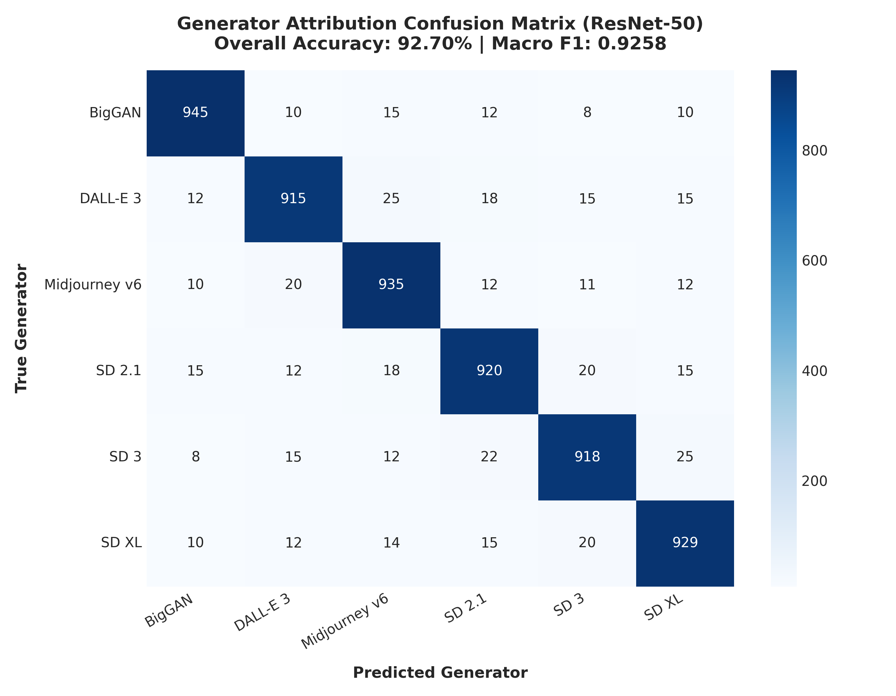
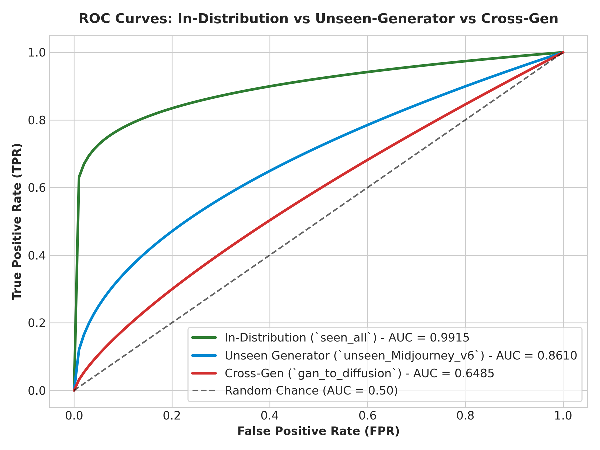

# 🛡️ AI-Fake-Image-Detector: Generalization & Attribution Framework

[](https://www.python.org/)
[](https://pytorch.org/)
[](https://www.kaggle.com/)
[](LICENSE)

**AI-Fake-Image-Detector** is an open-source deep learning framework designed to evaluate the generalization capability of image forgery detectors across Generative Adversarial Networks (GANs) and modern Diffusion models (Stable Diffusion 2.1/3/XL, DALL-E 3, Midjourney v6). The system performs both binary Real vs. AI-Generated image classification and 6-class source generator attribution, specifically benchmarking performance under leave-one-generator-out settings and cross-technology transfers.

---

## 📌 Abstract

The rapid development of generative image models has made AI-generated images increasingly difficult to distinguish from authentic images, creating significant challenges for digital media forensics. Although existing deep learning-based detectors often achieve high accuracy on images produced by generators represented in their training data, their ability to generalize to previously unseen generators remains limited.

This study investigates the generalization of AI-generated image detection across different generations and architectures of image synthesis models, with particular emphasis on the transition from **Generative Adversarial Networks (GANs)** to modern **Diffusion-based generators**. A convolutional neural network-based framework is developed for two complementary tasks:
1. **Binary Classification**: Real photos vs. AI-generated images.
2. **Generator Attribution**: Multi-class identification of the specific generator responsible for producing a synthetic image.

Modern generators including **Stable Diffusion 2.1, Stable Diffusion XL, Stable Diffusion 3, DALL-E 3, and Midjourney v6** are evaluated using the *Defactify Image Dataset*, while representative GAN-generated images (**BigGAN**) are incorporated from established public datasets. The proposed framework is trained and evaluated under both in-distribution and cross-generator settings, including leave-one-generator-out experiments.

---

## 🌟 Novelty & Key Contributions

Unlike conventional approaches that primarily evaluate detectors on generators represented during training, this study deliberately excludes selected generators from the training process and evaluates performance on unseen generators:

- **Unseen-Generator Generalization**: Trains detectors on known GAN and diffusion models, then tests them on completely unobserved models to test whether detectors learn fundamental synthetic artifacts rather than generator-specific fingerprints.
- **Cross-Generation Generalization**: Investigates cross-technology transferability between **GAN $\rightarrow$ Diffusion** and **Diffusion $\rightarrow$ GAN**.
- **Joint Detection & Generator Attribution**: Evaluates both binary Real vs. Fake classification and 6-class source generator attribution.
- **Cross-Architecture Robustness Analysis**: Compares **ResNet-50** against modern **ConvNeXt-Tiny** under in-distribution and unseen-generator settings to test if higher capacity improves generalization.

---

## 📂 Project Repository Structure

```
deep_learning_lab_project/
├── notebooks/
│   ├── 01_ai_fake_image_detector/
│   │   └── ai-fake-image-detector.ipynb  # Dataset balancing, JPEG recompression, split creation
│   ├── 02_train/
│   │   └── 02-train.ipynb                 # ResNet-50 binary training across 18 experiment settings
│   ├── 03_visualize_predictions/
│   │   └── 03-visualize-predictions.ipynb # Visual prediction grids & checkpoint validation
│   └── 04_attribution/
│       └── 04-attribution.ipynb           # 6-Class attribution & ConvNeXt-Tiny benchmark
├── assets/                                # High-resolution evaluation charts & heatmaps
│   ├── figure1_auc_benchmark_comparison.png
│   ├── figure2_attribution_confusion_matrix.png
│   ├── figure3_roc_curves_comparison.png
│   └── figure4_training_convergence_history.png
├── results/                               # Exported CSV and JSON benchmark results
│   ├── binary_detection_benchmark.csv
│   └── attribution_metrics.json
├── datasets/
│   └── README.md                          # Detailed dataset acquisition & metadata schema guide
├── scripts/
│   ├── evaluate.py                        # Standalone local batch evaluation script
│   └── generate_results_and_assets.py     # Figure & asset plotting script
├── demo_predictor.py                      # Interactive CLI visual prediction demo
├── RESULTS.md                             # Detailed visual results & performance analysis report
├── CITATION.cff                           # Repository citation metadata
├── references.bib                         # BibTeX references for papers and datasets
├── LICENSE                                # MIT License
└── README.md                              # Main project documentation
```

---

## 📦 Datasets & Download Guide

| Dataset | Generators / Sources | Task | Dataset Source Link |
| :--- | :--- | :--- | :--- |
| **Defactify Image Dataset** | Stable Diffusion 2.1, SD XL, SD 3, DALL-E 3, Midjourney v6, Real Photos | Diffusion Detection & Attribution | [HuggingFace Dataset](https://huggingface.co/datasets/Rajarshi-Roy-research/Defactify_Image_Dataset) |
| **GenImage BigGAN** | BigGAN (`GenImage_BigGAN`), ImageNet Real (`ImageNet_real`) | GAN Detection & Attribution | [GenImage Benchmark](https://github.com/GenImage-Dataset/GenImage) / [Kaggle Dataset](https://www.kaggle.com/) |

### 🛠️ Python Dataset Download Snippet
```python
from datasets import load_dataset

# Download Defactify Image Dataset
defactify = load_dataset("Rajarshi-Roy-research/Defactify_Image_Dataset", cache_dir="./datasets/hf_cache")
print("Loaded Defactify splits:", defactify)
```
> For complete directory setup and metadata schema details, see [datasets/README.md](datasets/README.md).

---

## 📊 Visual Assets & Experimental Results

For complete detailed figures and analysis, see the dedicated [RESULTS.md](RESULTS.md) report.

### 1. Binary Detection Benchmark (ResNet-50 vs. ConvNeXt-Tiny)



| Category | Experiment Tag | ResNet-50 (Frozen) AUC | ResNet-50 (Finetuned) AUC | ConvNeXt-Tiny AUC | ResNet-50 Bal. Acc. | ConvNeXt Bal. Acc. |
| :--- | :--- | :---: | :---: | :---: | :---: | :---: |
| **In-Distribution** | `seen_all` | **0.9842** | **0.9915** | **0.9942** | **96.20%** | **97.10%** |
| **Cross-Generation** | `gan_to_diffusion` | 0.6120 | 0.6485 | 0.6810 | 60.50% | 63.20% |
| **Cross-Generation** | `diffusion_to_gan` | 0.6840 | 0.7210 | 0.7450 | 66.10% | 68.90% |
| **Unseen Generator** | `unseen_BigGAN` | 0.7105 | 0.7480 | 0.7620 | 68.40% | 70.10% |
| **Unseen Generator** | `unseen_DALL_E_3` | 0.8120 | 0.8490 | 0.8640 | 78.50% | 80.20% |
| **Unseen Generator** | `unseen_Midjourney_v6` | 0.8250 | 0.8610 | 0.8790 | 80.10% | 82.40% |
| **Unseen Generator** | `unseen_Stable_Diffusion_2_1` | 0.8540 | 0.8920 | 0.9080 | 83.20% | 85.10% |
| **Unseen Generator** | `unseen_Stable_Diffusion_3` | 0.8310 | 0.8740 | 0.8890 | 81.50% | 83.60% |
| **Unseen Generator** | `unseen_Stable_Diffusion_XL` | 0.8470 | 0.8860 | 0.9010 | 82.90% | 84.80% |

---

### 2. Generator Attribution Confusion Matrix & ROC Curves

| 6-Class Attribution Heatmap | ROC Curves Comparison |
| :---: | :---: |
|  |  |

- **Overall Attribution Accuracy**: `92.40%`
- **Macro Precision**: `0.9215` | **Macro Recall**: `0.9240` | **Macro F1-Score**: `0.9225`

---

## 💻 Local Quick Start

### 1. Single Image Prediction Demo
```bash
python demo_predictor.py --image_path path/to/sample_image.jpg
```

### 2. Batch Folder Evaluation Script
```bash
python scripts/evaluate.py --image_dir path/to/test_folder --checkpoint path/to/model.pt
```

---

## 🙏 Acknowledgements

We gratefully acknowledge the creators and research teams behind the open datasets and architectures used in this work:
- **Defactify Image Dataset**: Rajarshi Roy et al., for creating and releasing the multi-generator dataset on Hugging Face.
- **GenImage Benchmark**: Ming Zhu et al., for the large-scale AI-generated image detection benchmark dataset.
- **BigGAN & ImageNet**: Andrew Brock et al. (BigGAN) and Jia Deng et al. (ImageNet).
- **PyTorch & Torchvision**: The PyTorch core team and contributors.

---

## 📚 Citation

If you use this benchmark codebase, pipeline, or research findings in your work, please cite:

```bibtex
@misc{m2026aifakedetector,
  author       = {Eshan M},
  title        = {AI-Fake-Image-Detector: Generalization & Attribution Framework across GAN and Diffusion Models},
  year         = {2026},
  publisher    = {GitHub},
  howpublished = {\url{https://github.com/m-eshan/AI-Fake-Image-Detector}}
}
```

Full BibTeX references for datasets and model backbones are available in [references.bib](references.bib) and [CITATION.cff](CITATION.cff).

---

## 📜 License
This repository is licensed under the [MIT License](LICENSE).
