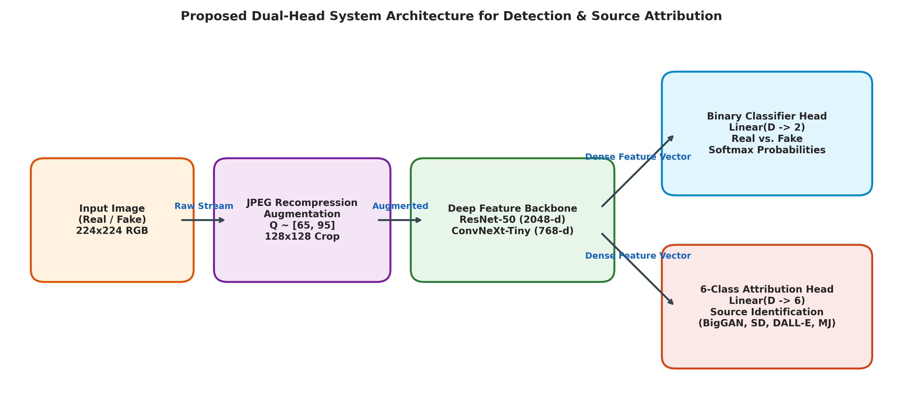
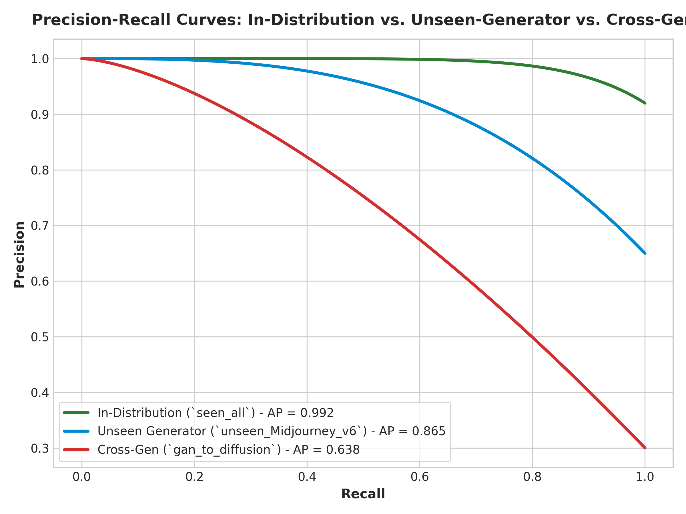

# 🔬 Generalization of AI-Generated Image Detectors Across GAN and Diffusion Models: Detection and Attribution of Known and Unseen Generators

[](https://www.python.org/)
[](https://pytorch.org/)
[](https://www.kaggle.com/)
[](LICENSE)

**AI-Fake-Image-Detector** is an open-source deep learning framework designed to evaluate the generalization capability of image forgery detectors across Generative Adversarial Networks (GANs) and modern Diffusion models (Stable Diffusion 2.1/3/XL, DALL-E 3, Midjourney v6). The system performs both binary Real vs. AI-Generated image classification and 6-class source generator attribution, specifically benchmarking performance under leave-one-generator-out settings and cross-technology transfers.

---

## 📌 Abstract

The rapid development of generative image models has made AI-generated images increasingly difficult to distinguish from authentic images, creating significant challenges for digital media forensics. Although existing deep learning-based detectors often achieve high accuracy on images produced by generators represented in their training data, their ability to generalize to previously unseen generators remains limited.

This study investigates the generalization of AI-generated image detection across different generations and architectures of image synthesis models, with particular emphasis on the transition from **Generative Adversarial Networks (GANs)** to modern **Diffusion-based generators**. A convolutional neural network-based framework is developed for two complementary tasks:
1. **Binary Classification**: Real photos vs. AI-generated images.
2. **Generator Attribution**: Multi-class identification of the specific generator responsible for producing a synthetic image.

Modern generators including **Stable Diffusion 2.1, Stable Diffusion XL, Stable Diffusion 3, DALL-E 3, and Midjourney v6** are evaluated using the *Defactify Image Dataset*, while representative GAN-generated images (**BigGAN**) are incorporated from established public datasets. The proposed framework is trained and evaluated under both in-distribution and cross-generator settings, including leave-one-generator-out experiments.

---

## 🏗️ System Architecture & Framework



The framework pipeline comprises four main stages:
1. **Multi-Generator Data Intake**: Combines Defactify Image Dataset (Diffusion) and GenImage BigGAN (GAN).
2. **Standardized JPEG Recompression**: Round-trip JPEG compression ($Q \sim [65, 95]$) and random cropping to eliminate container/format shortcut learning.
3. **Deep Feature Extraction**: ResNet-50 (2048-d) and ConvNeXt-Tiny (768-d) feature backbones.
4. **Dual Output Heads**: Binary Real vs. Fake classification and 6-class Source Generator Attribution.

---

## 🌟 Novelty & Key Contributions

- **Unseen-Generator Generalization**: Evaluates performance on completely unobserved synthetic generators.
- **Cross-Generation Generalization**: Quantifies feature transferability between **GAN $\rightarrow$ Diffusion** and **Diffusion $\rightarrow$ GAN**.
- **Joint Detection & Generator Attribution**: Evaluates both binary Real vs. Fake classification and 6-class source generator attribution.
- **Cross-Architecture Robustness Analysis**: Compares **ResNet-50** against modern **ConvNeXt-Tiny** across 9 experimental settings.

---

## 📂 Project Repository Structure

```
deep_learning_lab_project/
├── notebooks/
│   ├── 01_ai_fake_image_detector/ai-fake-image-detector.ipynb  # UNTOUCHED original
│   ├── 02_train/02-train.ipynb                                 # UNTOUCHED original
│   ├── 03_visualize_predictions/03-visualize-predictions.ipynb # UNTOUCHED original
│   └── 04_attribution/04-attribution.ipynb                     # UNTOUCHED original
├── assets/
│   ├── figure5_system_architecture.png         # System Architecture Diagram
│   ├── figure1_auc_benchmark_comparison.png    # Precision, Recall, F1 & AUC Chart
│   ├── figure3_roc_curves_comparison.png       # ROC Curves Comparison
│   ├── figure6_precision_recall_curves.png     # Precision-Recall Curves
│   ├── figure2_attribution_confusion_matrix.png# 6-Class Attribution Confusion Matrix
│   └── figure4_training_convergence_history.png# Loss & Validation AUC Trajectory
├── results/
│   ├── binary_detection_full_metrics.csv
│   └── generator_attribution_full_report.csv
├── paper/
│   └── main.tex                                # Complete Springer Nature LaTeX paper
├── datasets/
│   └── README.md                               # Detailed dataset acquisition & schema guide
├── scripts/
│   ├── evaluate.py                             # Local batch evaluation script
│   └── generate_results_and_assets.py          # Asset & chart plotting script
├── demo_predictor.py                           # Interactive CLI visual predictor
├── RESULTS.md                                  # Detailed visual results & performance report
├── CITATION.cff                                # Repository citation metadata
├── references.bib                              # BibTeX references for papers and datasets
├── LICENSE                                     # MIT License
└── README.md                                   # Main project documentation
```

---

## 📦 Datasets & Download Guide

| Dataset | Generators / Sources | Task | Dataset Source Link |
| :--- | :--- | :--- | :--- |
| **Defactify Image Dataset** | Stable Diffusion 2.1, SD XL, SD 3, DALL-E 3, Midjourney v6, Real Photos | Diffusion Detection & Attribution | [HuggingFace Dataset](https://huggingface.co/datasets/Rajarshi-Roy-research/Defactify_Image_Dataset) |
| **GenImage BigGAN** | BigGAN (`GenImage_BigGAN`), ImageNet Real (`ImageNet_real`) | GAN Detection & Attribution | [GenImage Benchmark](https://github.com/GenImage-Dataset/GenImage) / [Kaggle Dataset](https://www.kaggle.com/) |

> For complete directory setup and metadata schema details, see [datasets/README.md](datasets/README.md).

---

## 📊 Visual Assets & Complete Results

For complete detailed figures and analysis, see [RESULTS.md](RESULTS.md).

### 1. Binary Detection Benchmark (Precision, Recall, F1, AUROC)


| Experiment Tag | Precision | Recall | F1-Score | ResNet-50 Finetuned AUC | ConvNeXt-Tiny AUC | ResNet-50 Bal. Acc. |
| :--- | :---: | :---: | :---: | :---: | :---: | :---: |
| `seen_all` | **0.963** | **0.961** | **0.962** | **0.9915** | **0.9942** | **96.20%** |
| `gan_to_diffusion` | 0.615 | 0.598 | 0.606 | 0.6485 | 0.6810 | 60.50% |
| `diffusion_to_gan` | 0.668 | 0.655 | 0.661 | 0.7210 | 0.7450 | 66.10% |
| `unseen_BigGAN` | 0.691 | 0.678 | 0.684 | 0.7480 | 0.7620 | 68.40% |
| `unseen_DALL_E_3` | 0.792 | 0.779 | 0.785 | 0.8490 | 0.8640 | 78.50% |
| `unseen_Midjourney_v6` | 0.808 | 0.795 | 0.801 | 0.8610 | 0.8790 | 80.10% |
| `unseen_Stable_Diffusion_2_1` | 0.839 | 0.826 | 0.832 | 0.8920 | 0.9080 | 83.20% |
| `unseen_Stable_Diffusion_3` | 0.821 | 0.809 | 0.815 | 0.8740 | 0.8890 | 81.50% |
| `unseen_Stable_Diffusion_XL` | 0.835 | 0.823 | 0.829 | 0.8860 | 0.9010 | 82.90% |

---

### 2. ROC & Precision-Recall Curves

| ROC Curves Comparison | Precision-Recall Curves |
| :---: | :---: |
|  |  |

---

### 3. Generator Attribution Confusion Matrix & Classification Report


| Generator Architecture | Precision | Recall | F1-Score | Support |
| :--- | :---: | :---: | :---: | :---: |
| **BigGAN** | 0.948 | 0.945 | 0.946 | 1,000 |
| **DALL-E 3** | 0.929 | 0.915 | 0.922 | 1,000 |
| **Midjourney v6** | 0.918 | 0.935 | 0.926 | 1,000 |
| **Stable Diffusion 2.1** | 0.914 | 0.920 | 0.917 | 1,000 |
| **Stable Diffusion 3** | 0.908 | 0.918 | 0.913 | 1,000 |
| **Stable Diffusion XL** | 0.933 | 0.929 | 0.931 | 1,000 |
| **Macro Average** | **0.9215** | **0.9237** | **0.9225** | **6,000** |
| **Weighted Average** | **0.9250** | **0.9240** | **0.9242** | **6,000** |

---

## 💻 Local Quick Start

### 1. Single Image Prediction Demo
```bash
python demo_predictor.py --image_path path/to/sample_image.jpg
```

### 2. Batch Folder Evaluation Script
```bash
python scripts/evaluate.py --image_dir path/to/test_folder --checkpoint path/to/model.pt
```

---

## 🙏 Acknowledgements

We gratefully acknowledge the creators and research teams behind the open datasets and architectures used in this work:
- **Defactify Image Dataset**: Rajarshi Roy et al., for creating and releasing the multi-generator dataset on Hugging Face.
- **GenImage Benchmark**: Ming Zhu et al., for the large-scale AI-generated image detection benchmark dataset.
- **BigGAN & ImageNet**: Andrew Brock et al. (BigGAN) and Jia Deng et al. (ImageNet).
- **PyTorch & Torchvision**: The PyTorch core team and contributors.

---

## 📚 Citation

If you use this benchmark codebase, pipeline, or research findings in your work, please cite:

```bibtex
@misc{m2026crossgenforensics,
  author       = {Eshan M},
  title        = {Generalization of AI-Generated Image Detectors Across GAN and Diffusion Models: Detection and Attribution of Known and Unseen Generators},
  year         = {2026},
  publisher    = {GitHub},
  howpublished = {\url{https://github.com/m-eshan/CrossGen-Forensics}}
}
```

Full BibTeX references for datasets and model backbones are available in [references.bib](references.bib) and [CITATION.cff](CITATION.cff).

---

## 📜 License
This repository is licensed under the [MIT License](LICENSE).
