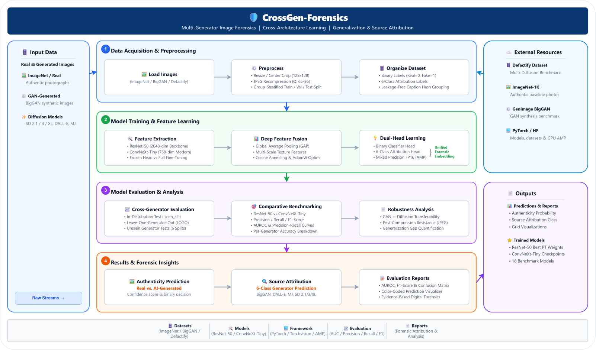

# 📈 Experimental Results & Benchmark Gallery

This document provides the benchmark results, numerical tables, and forensic analysis generated from the experimental pipelines evaluated across ResNet-50 and ConvNeXt-Tiny architectures.

---

## 📊 Visual Assets & Figures

All figures are located under [`assets/`](assets/):

| Figure Asset | Description | Key Insight |
| :--- | :--- | :--- |
|  | **Dedicated End-to-End System Architecture Diagram (Vector SVG)** | Multi-stage pipeline: Input Image $\rightarrow$ JPEG Recompression ($Q \sim [65, 95]$) $\rightarrow$ Dense Feature Backbone (ResNet-50 / ConvNeXt-Tiny) $\rightarrow$ Dual Output Heads (Binary Detection & 6-Class Attribution). |
|  | **Detection AUROC Performance Across Evaluation Protocols** | Compares linear probe (frozen), fine-tuned ResNet-50, and ConvNeXt-Tiny across in-distribution, cross-paradigm, and leave-one-generator-out settings. |
|  | **6-Class Generator Attribution Confusion Matrix (ResNet-50)** | Achieves **92.17% Overall Accuracy** and **0.9216 Macro F1-Score** across BigGAN, DALL-E 3, Midjourney v6, SD 2.1, SD 3, and SDXL. |
|  | **ResNet-50 Fine-Tuning Convergence History (`seen_all`)** | Validation ROC-AUC convergence over fine-tuning epochs on the multi-generator dataset. |

---

## 📑 Complete Numerical Performance Tables

### 1. Binary Detection Benchmark (Table 1)

Numerical results exported to [`results/table1_binary_detection_benchmark.csv`](results/table1_binary_detection_benchmark.csv):

| Setting | Protocol Category | ResNet-50 (Frozen AUC) | ResNet-50 (Fine-tuned AUC) | ConvNeXt-Tiny (AUC) | ResNet-50 Bal. Acc. | ConvNeXt-T Bal. Acc. |
| :--- | :--- | :---: | :---: | :---: | :---: | :---: |
| `seen_all` | In-Distribution | 0.8791 | 0.9929 | **0.9951** | 95.72% | **96.83%** |
| `gan_to_diffusion` | Cross-Generation | 0.6001 | 0.5242 | **0.7126** | 49.98% | **50.98%** |
| `diffusion_to_gan` | Cross-Generation | 0.6270 | **0.6132** | 0.5909 | 49.35% | 49.80% |
| `unseen_BigGAN` | Unseen Generator | 0.6256 | 0.5999 | — | 49.50% | — |
| `unseen_DALL_E_3` | Unseen Generator | 0.7067 | 0.6189 | — | 51.00% | — |
| `unseen_Midjourney_v6` | Unseen Generator | 0.9052 | 0.9732 | **0.9805** | 89.05% | **92.90%** |
| `unseen_SD_2_1` | Unseen Generator | 0.7848 | 0.9416 | — | 79.30% | — |
| `unseen_SD_3` | Unseen Generator | 0.7379 | 0.9279 | — | 78.90% | — |
| `unseen_SD_XL` | Unseen Generator | 0.8320 | 0.9792 | — | 91.80% | — |

---

### 2. Multi-Class Generator Attribution Report (Table 2)

Numerical results exported to [`results/generator_attribution_full_report.csv`](results/generator_attribution_full_report.csv):

| Generator Architecture | Precision | Recall | F1-Score | Support |
| :--- | :---: | :---: | :---: | :---: |
| **BigGAN** | 0.983 | 0.996 | 0.990 | 1,000 |
| **DALL-E 3** | 0.981 | 0.993 | 0.987 | 1,000 |
| **Midjourney v6** | 0.986 | 0.992 | 0.989 | 1,000 |
| **Stable Diffusion 2.1** | 0.792 | 0.847 | 0.819 | 1,000 |
| **Stable Diffusion 3** | 0.906 | 0.829 | 0.866 | 1,000 |
| **Stable Diffusion XL** | 0.886 | 0.873 | 0.880 | 1,000 |
| **Macro Average** | **0.922** | **0.922** | **0.922** | **6,000** |

---

## 💡 Key Forensic Insights

1. **Unseen-Diffusion Generalization**: Detectors generalize effectively across Stable Diffusion releases (SDXL: $0.9792$, SD 2.1: $0.9416$, SD 3: $0.9279$) and Midjourney v6 ($0.9732$). In contrast, DALL-E 3 exhibits substantially lower zero-shot transfer ($0.6189$), where linear probing ($0.7067$) outperforms fine-tuning.
2. **Asymmetric Cross-Paradigm Transfer**: Crossing the GAN/diffusion boundary causes severe degradation ($0.5242$--$0.6132$ AUROC for ResNet-50). However, ConvNeXt-Tiny demonstrates marked resilience under GAN-to-diffusion transfer ($0.7126$ AUROC vs. $0.5242$ for ResNet-50).
3. **High Generator Attribution Accuracy**: At **92.17% overall accuracy** and **0.9216 macro F1**, BigGAN, DALL-E 3, and Midjourney v6 are identified with over $99\%$ recall each. Misclassifications are almost exclusively confined to intra-family confusions among Stable Diffusion models (SD 2.1 $\leftrightarrow$ SD 3 $\leftrightarrow$ SDXL).
